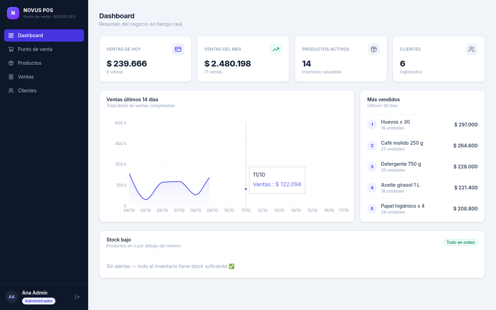
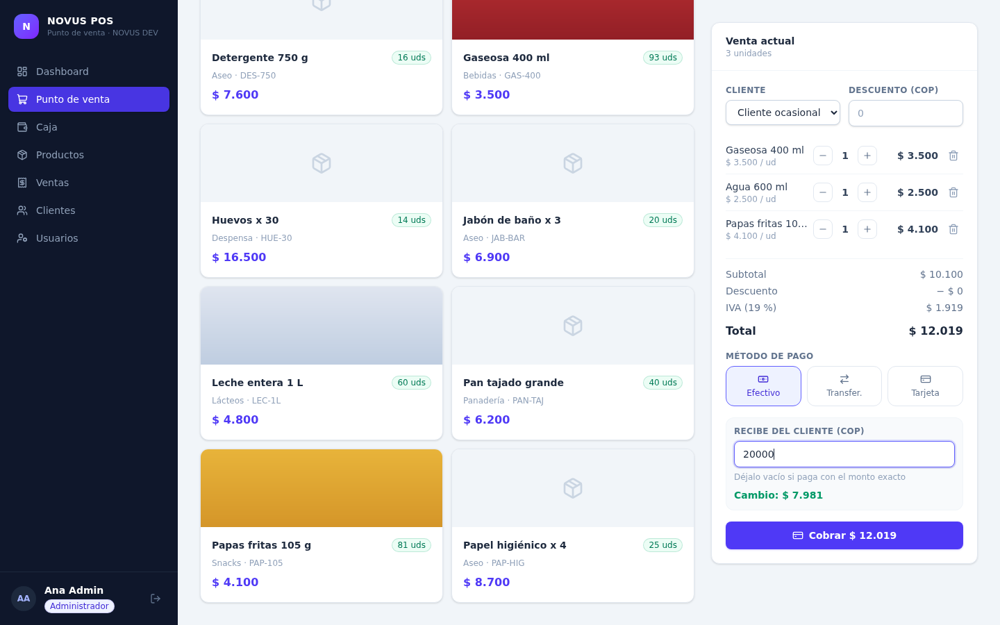
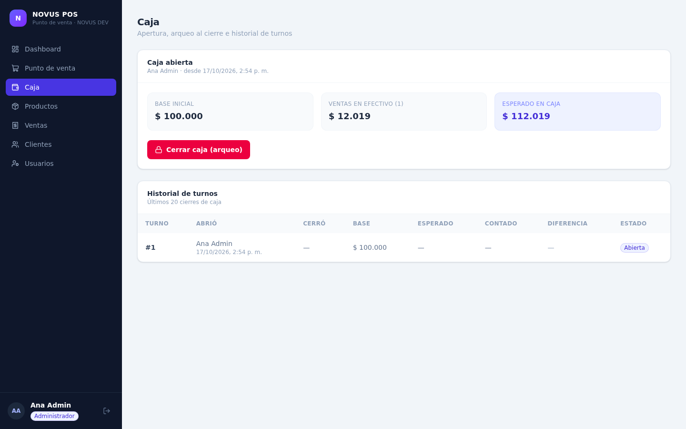
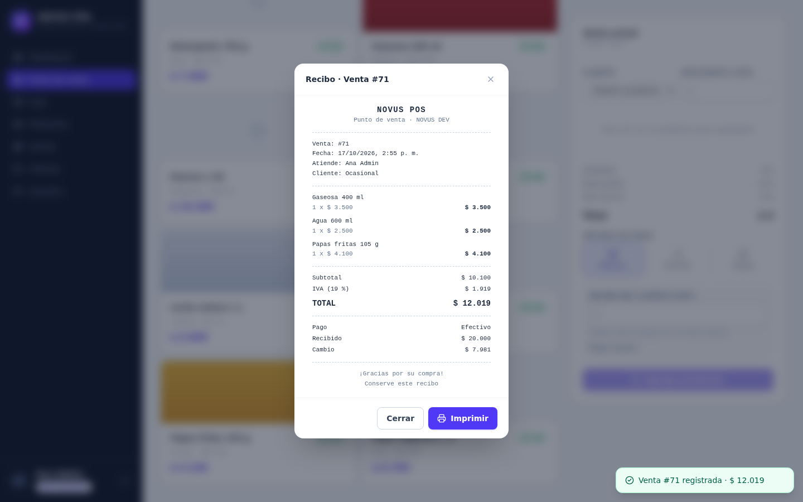
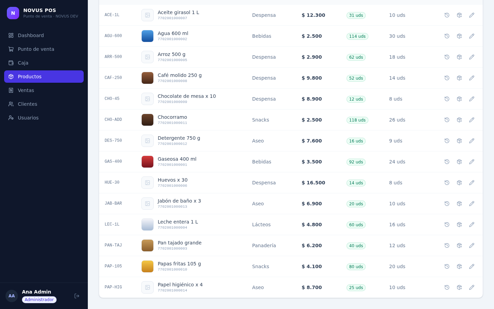
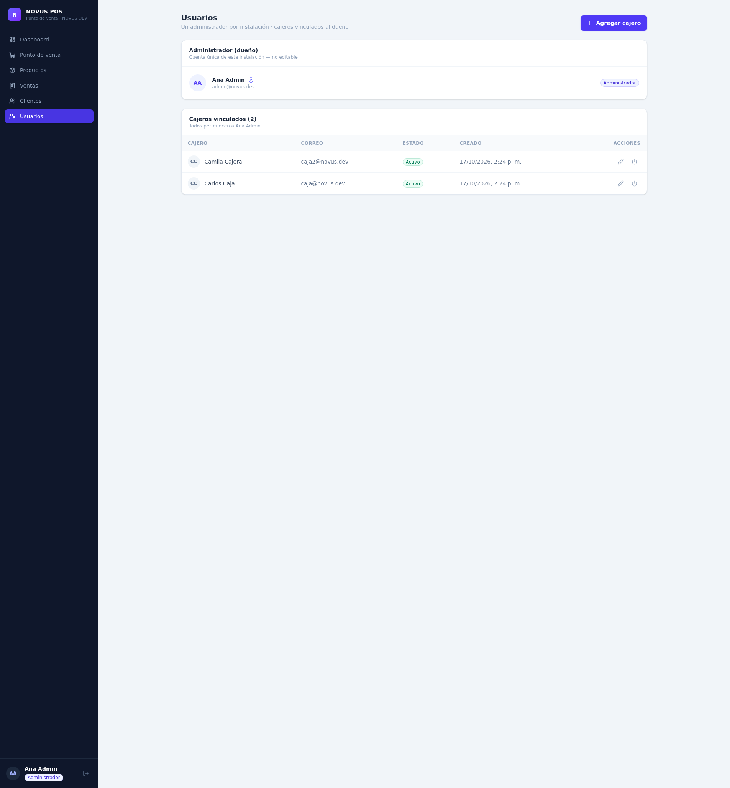

<div align="center">

# NOVUS POS 🧾

**Punto de venta e inventario para tiendas — by [NOVUS DEV](https://github.com/987rafa)**

[](https://github.com/987rafa/novus-pos/actions/workflows/ci.yml)


</div>

Sistema full-stack de punto de venta e inventario para negocios pequeños (tiendas, panaderías, minimercados): cobra ventas con escáner de código de barras (lector USB listo), recibe pagos en efectivo, transferencia o tarjeta con cambio automático, maneja turnos de caja con arqueo al cierre, imprime recibos, mantén el stock bajo control con historial completo de movimientos y mira el negocio en un dashboard en tiempo real.

> 🇬🇧 [Read in English](README.md)

## 📸 Capturas

| Dashboard | Punto de venta — escáner y cambio |
| --- | --- |
|  |  |

| Turno de caja (apertura + arqueo) | Recibo imprimible |
| --- | --- |
|  |  |

| Productos e inventario (con fotos) | Usuarios y cajeros |
| --- | --- |
|  |  |

## ✨ Funcionalidades

- 🖥️ **Interfaz web en español** (React + TypeScript, adaptable a móvil): caja con carrito, gestión de productos y stock, usuarios (dueño + cajeros), historial de ventas y dashboard
- 🛒 **Ventas con carrito** — múltiples productos por venta, descuentos, IVA 19 % automático, stock validado y descontado en una sola transacción
- 🏷️ **Escáner de código de barras** — código EAN-13 por producto; el lector USB solo "escribe" el código y con Enter el producto cae al carrito (incluye endpoint de búsqueda exacta)
- 📷 **Fotos de producto** — sube imágenes JPG/PNG/WebP (≤ 2 MB) desde la interfaz, validadas por firma real del archivo (no por extensión) y servidas por la API
- 💳 **Métodos de pago** — efectivo (monto recibido y cambio automático), transferencia o tarjeta; quedan guardados en cada venta y en el recibo
- 💰 **Turnos de caja** — abre el turno con una base inicial, mira el esperado en vivo (base + ventas en efectivo) y ciérralo con arqueo (contado vs esperado, diferencia registrada); una sola caja abierta a la vez
- 🧾 **Recibo imprimible** — tirilla en pantalla con negocio, ítems, IVA, pago, recibido y cambio; el CSS de impresión deja solo la tirilla en el papel
- 📦 **Inventario con auditoría** — cada entrada/salida queda registrada (stock inicial, compras, ajustes, mermas, ventas, anulaciones); alertas de stock bajo configurables
- ↔️ **Anular y reponer** — cancela una venta (solo admin) y el stock vuelve solo, con registro
- 👥 **Clientes** — cliente opcional por venta, búsqueda por nombre o teléfono
- 📊 **Dashboard** — ventas de hoy/mes, serie de 14 días, productos más vendidos, lista de stock bajo
- 🔐 **Login con roles** — exactamente **un administrador (el dueño)** por instalación + cajeros vinculados al dueño; contraseñas con argon2
- 🧪 **Con pruebas** — suite de 51 tests sobre auth, productos, códigos de barras y fotos, movimientos, ventas, pagos, caja y dashboard
- 🐳 **Un comando y listo** — Docker Compose (web + API + PostgreSQL)

## 🧰 Stack

| Capa | Tecnología |
| --- | --- |
| Frontend | React 19 · TypeScript · Vite · Tailwind CSS 4 · TanStack Query · Recharts |
| API | FastAPI · SQLAlchemy 2.0 · Pydantic v2 |
| BD | PostgreSQL (Docker/producción) · SQLite (desarrollo) |
| Auth | JWT (PyJWT) · argon2 (pwdlib) |
| Herramientas | pytest · oxlint · Docker Compose · GitHub Actions |

## 🚀 Arranque rápido

### Docker (recomendado)

```bash
docker compose up --build
# Interfaz web → http://localhost:3000
# Docs de la API → http://localhost:8000/docs
```

### Desarrollo local

```bash
# 1. Backend (http://127.0.0.1:8000)
cd backend
python -m venv .venv && source .venv/bin/activate
pip install -e ".[dev]"
cp .env.example .env
SEED_ON_STARTUP=true python -m uvicorn app.main:app --reload

# 2. Frontend (http://localhost:5173, proxy /api → :8000)
cd ../frontend
npm install
npm run dev
```

### Credenciales demo (creadas por el seed)

| Rol | Correo | Contraseña |
| --- | --- | --- |
| Admin (dueño) | `admin@novus.dev` | `Admin123*` |
| Cajero | `caja@novus.dev` | `Caja123*` |
| Cajero 2 | `caja2@novus.dev` | `Caja123*` |

> ℹ️ Cada instalación tiene exactamente **un administrador** (el dueño). Los cajeros se crean desde **Usuarios** y quedan vinculados al dueño: no pueden ver ni gestionar usuarios.
> ⚠️ Solo para demo — cámbialas antes de usarlo en serio (`ADMIN_EMAIL` / `ADMIN_PASSWORD`).

## 🧪 Pruebas

```bash
cd backend && python -m pytest -q   # 51 tests
cd frontend && npm run build        # type-check + build de producción
```

## 🔌 Resumen de la API

| Área | Endpoints |
| --- | --- |
| Auth | `POST /api/auth/login` · `GET /api/auth/me` |
| Productos | CRUD + `GET /api/products/barcode/{code}` · `POST /api/products/{id}/image` · `POST /api/products/{id}/stock-adjust` · `GET /api/products/{id}/movements` |
| Clientes | CRUD con búsqueda |
| Ventas | `POST /api/sales` (método de pago + cambio) · listado/detalle · `POST /api/sales/{id}/void` (admin) |
| Caja | `GET /api/cash/status` · `POST /api/cash/open` · `POST /api/cash/close` (arqueo) · `GET /api/cash/sessions` |
| Dashboard | `summary` · `sales-series` · `top-products` · `low-stock` |
| Usuarios | solo admin: listar · crear cajeros vinculados · editar/desactivar (un solo admin por instalación) |

Referencia interactiva completa en `/docs` (OpenAPI/Swagger).

## 🗺️ Roadmap

- [x] API backend: ventas, inventario, dashboard, roles y pruebas
- [x] Interfaz web (React + TypeScript): caja, productos, ventas, clientes y dashboard
- [x] Bloque de caja: códigos de barras y lector USB, fotos de producto, métodos de pago, turnos de caja con arqueo y recibo imprimible
- [ ] Demo en vivo
- [ ] Pedidos por WhatsApp — los pedidos entran solos al POS (se conecta con [whatsapp-ai-agent](https://github.com/987rafa/whatsapp-ai-agent))

## 📄 Licencia

MIT © [Rafael Álvarez · NOVUS DEV](https://github.com/987rafa)
