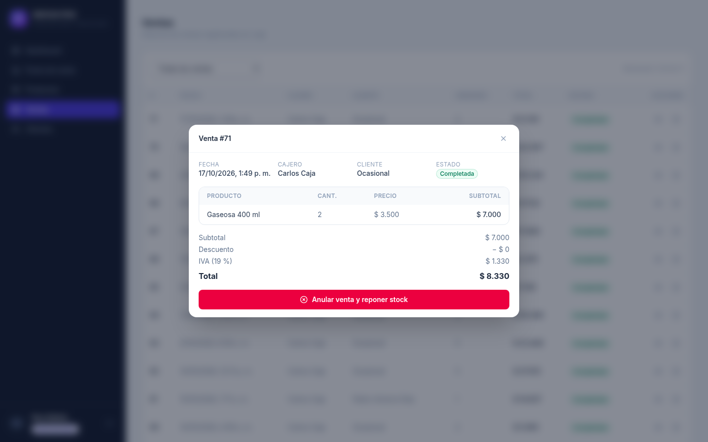
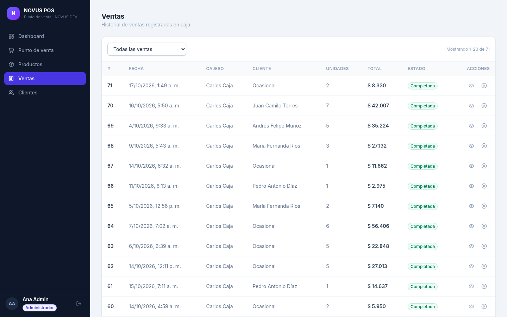
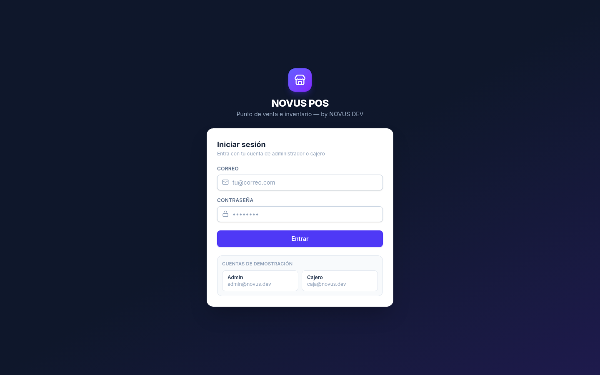

<div align="center">

# NOVUS POS 🧾

**Punto de venta e inventario para tiendas — by [NOVUS DEV](https://github.com/987rafa)**

[](https://github.com/987rafa/novus-pos/actions/workflows/ci.yml)


</div>

Sistema full-stack de punto de venta e inventario para negocios pequeños (tiendas, panaderías, minimercados): registra ventas con carrito e IVA 19 % automático, mantén el stock bajo control con historial completo de movimientos y mira el negocio en un dashboard en tiempo real.

> 🇬🇧 [Read in English](README.md)

## 📸 Capturas

| Dashboard | Punto de venta |
| --- | --- |
|  |  |

| Productos e inventario | Detalle de venta |
| --- | --- |
|  |  |

| Historial de ventas | Inicio de sesión |
| --- | --- |
|  |  |

## ✨ Funcionalidades

- 🖥️ **Interfaz web en español** (React + TypeScript, adaptable a móvil): caja con carrito, gestión de productos y stock, historial de ventas y dashboard
- 🛒 **Ventas con carrito** — múltiples productos por venta, descuentos, IVA 19 % automático, stock validado y descontado en una sola transacción
- 📦 **Inventario con auditoría** — cada entrada/salida queda registrada (stock inicial, compras, ajustes, mermas, ventas, anulaciones); alertas de stock bajo configurables
- ↔️ **Anular y reponer** — cancela una venta (solo admin) y el stock vuelve solo, con registro
- 👥 **Clientes** — cliente opcional por venta, búsqueda por nombre o teléfono
- 📊 **Dashboard** — ventas de hoy/mes, serie de 14 días, productos más vendidos, lista de stock bajo
- 🔐 **Login con roles** — `admin` / `cajero`, contraseñas con argon2
- 🧪 **Con pruebas** — suite de 26 tests sobre auth, productos, movimientos, ventas y dashboard
- 🐳 **Un comando y listo** — Docker Compose (web + API + PostgreSQL)

## 🧰 Stack

| Capa | Tecnología |
| --- | --- |
| Frontend | React 19 · TypeScript · Vite · Tailwind CSS 4 · TanStack Query · Recharts |
| API | FastAPI · SQLAlchemy 2.0 · Pydantic v2 |
| BD | PostgreSQL (Docker/producción) · SQLite (desarrollo) |
| Auth | JWT (PyJWT) · argon2 (pwdlib) |
| Herramientas | pytest · oxlint · Docker Compose · GitHub Actions |

## 🚀 Arranque rápido

### Docker (recomendado)

```bash
docker compose up --build
# Interfaz web → http://localhost:3000
# Docs de la API → http://localhost:8000/docs
```

### Desarrollo local

```bash
# 1. Backend (http://127.0.0.1:8000)
cd backend
python -m venv .venv && source .venv/bin/activate
pip install -e ".[dev]"
cp .env.example .env
SEED_ON_STARTUP=true python -m uvicorn app.main:app --reload

# 2. Frontend (http://localhost:5173, proxy /api → :8000)
cd ../frontend
npm install
npm run dev
```

### Credenciales demo (creadas por el seed)

| Rol | Correo | Contraseña |
| --- | --- | --- |
| Admin | `admin@novus.dev` | `Admin123*` |
| Cajero | `caja@novus.dev` | `Caja123*` |

> ⚠️ Solo para demo — cámbialas antes de usarlo en serio.

## 🧪 Pruebas

```bash
cd backend && python -m pytest -q   # 26 tests
cd frontend && npm run build        # type-check + build de producción
```

## 🔌 Resumen de la API

| Área | Endpoints |
| --- | --- |
| Auth | `POST /api/auth/login` · `GET /api/auth/me` |
| Productos | CRUD + `POST /api/products/{id}/stock-adjust` · `GET /api/products/{id}/movements` |
| Clientes | CRUD con búsqueda |
| Ventas | `POST /api/sales` · listado/detalle · `POST /api/sales/{id}/void` (admin) |
| Dashboard | `summary` · `sales-series` · `top-products` · `low-stock` |
| Usuarios | CRUD solo admin |

Referencia interactiva completa en `/docs` (OpenAPI/Swagger).

## 🗺️ Roadmap

- [x] API backend: ventas, inventario, dashboard, roles y pruebas
- [x] Interfaz web (React + TypeScript): caja, productos, ventas, clientes y dashboard
- [ ] Demo en vivo
- [ ] Pedidos por WhatsApp — los pedidos entran solos al POS (se conecta con [whatsapp-ai-agent](https://github.com/987rafa/whatsapp-ai-agent))

## 📄 Licencia

MIT © [Rafael Álvarez · NOVUS DEV](https://github.com/987rafa)
