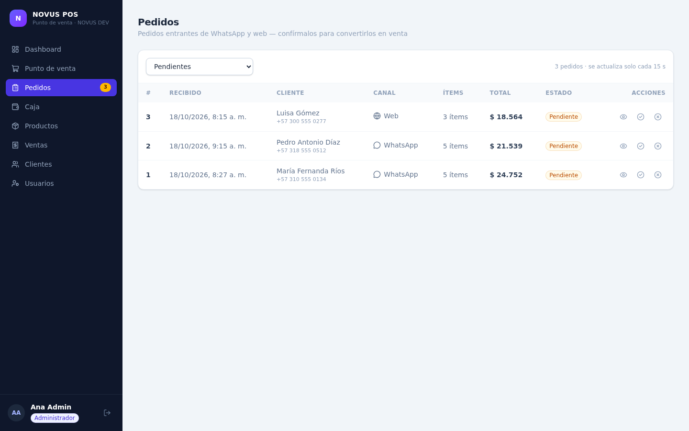
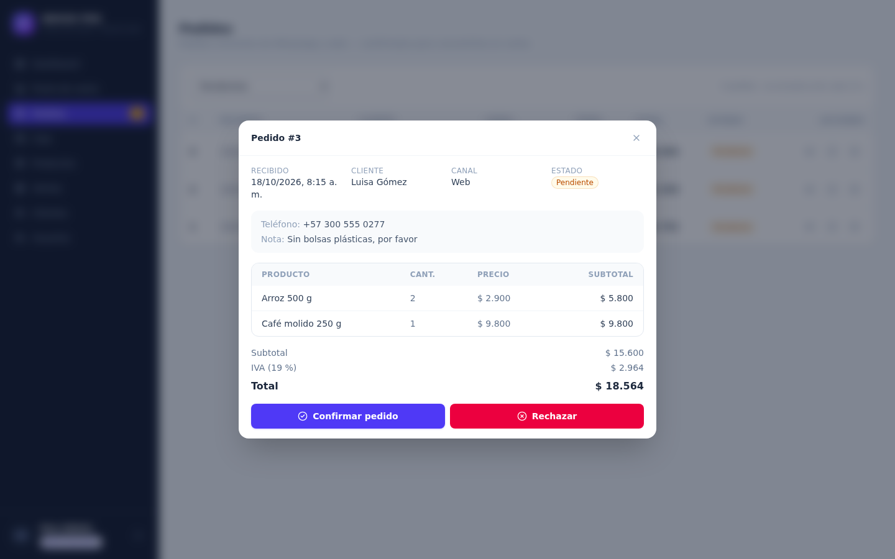

<div align="center">

# NOVUS POS 🧾

**Point of sale & inventory for small shops — by [NOVUS DEV](https://github.com/987rafa)**

[](https://github.com/987rafa/novus-pos/actions/workflows/ci.yml)


</div>

Full-stack point of sale and inventory system for small shops (tiendas, panaderías, minimercados): ring up sales with barcode scanning (USB scanner ready), take payments in cash, transfer or card with automatic change, run cash register sessions with an audit at closing time, print receipts, keep stock under control with a full movement history, watch the business with a real-time dashboard — and take **orders from WhatsApp** or the web that land in an orders queue and become a sale with one click.

> 🇪🇸 [Leer en español](README.es.md)

## 📸 Screenshots

| Dashboard | Point of sale — barcode scan, cash change |
| --- | --- |
|  |  |

| Cash register session (opening + audit) | Printable receipt |
| --- | --- |
|  |  |

| Products & inventory (with photos) | Users & cashiers |
| --- | --- |
|  |  |

| Orders — WhatsApp / web → POS | Order detail: confirm into a sale or reject |
| --- | --- |
|  |  |

## ✨ Features

- 🖥️ **Web UI in Spanish** (React + TypeScript, mobile-friendly): POS screen with cart, product & stock management, users (owner + linked cashiers), sales history and analytics dashboard
- 🛒 **Sales with cart** — multi-item sales, per-sale discounts, 19 % VAT applied automatically, stock validated & decremented in a single transaction
- 📥 **Incoming orders (WhatsApp / web)** — external channels (your WhatsApp bot or your website) create pending orders with an API key; the cashier confirms them into a real sale (stock, payment method, receipt) or rejects them with a reason. Pending count lives in the sidebar badge
- 🔌 **Orders API for integrations** — `X-API-Key` auth (`ORDERS_API_KEY`), live catalog endpoint (prices + stock) and a clean confirm/reject flow; pairs with [whatsapp-ai-agent](https://github.com/987rafa/whatsapp-ai-agent)
- 🏷️ **Barcode scanning** — EAN-13 barcode per product; a USB scanner simply types the code and Enter drops the product straight into the cart (exact-match lookup API included)
- 📷 **Product photos** — upload JPG/PNG/WebP images (≤ 2 MB) from the UI, validated by real file signature (not just the extension) and served by the API
- 💳 **Payment methods** — cash (amount received + automatic change), transfer or card; stored on every sale and printed on the receipt
- 💰 **Cash register sessions** — open a shift with an opening float, see the live expected amount (float + cash sales) and close it with an audit (counted vs expected, difference logged); one open session per installation
- 🧾 **Printable receipt** — on-screen ticket with store, items, VAT, payment, received & change; print CSS keeps only the ticket on paper
- 📦 **Inventory with audit trail** — every entry/exit is logged (initial stock, purchases, adjustments, losses, sales, voids); low-stock alerts with configurable minimums
- ↔️ **Void & restock** — cancel a sale (admin only) and stock flows back, fully logged
- 👥 **Customers** — optional customer on each sale, search by name or phone
- 📊 **Dashboard analytics** — sales today/month, 14-day series, top products, low-stock list
- 🔐 **JWT auth with roles** — exactly **one administrator (the owner)** per installation + cashiers linked to the owner; passwords hashed with argon2
- 🧪 **Tested** — 66-test pytest suite covering auth, products, barcodes & image upload, stock movements, sales, payments, cash register, dashboard and incoming orders
- 🐳 **One command to run** — Docker Compose (web + API + PostgreSQL)

## 🧰 Stack

| Layer | Tech |
| --- | --- |
| Frontend | React 19 · TypeScript · Vite · Tailwind CSS 4 · TanStack Query · Recharts |
| API | FastAPI · SQLAlchemy 2.0 · Pydantic v2 |
| DB | PostgreSQL (Docker/prod) · SQLite (local dev) |
| Auth | JWT (PyJWT) · argon2 (pwdlib) |
| Tooling | pytest · oxlint · Docker Compose · GitHub Actions |

## 🚀 Quickstart

### Docker (recommended)

```bash
docker compose up --build
# Web UI  → http://localhost:3000
# API docs → http://localhost:8000/docs
```

### Local development

```bash
# 1. Backend (http://127.0.0.1:8000)
cd backend
python -m venv .venv && source .venv/bin/activate
pip install -e ".[dev]"
cp .env.example .env
SEED_ON_STARTUP=true python -m uvicorn app.main:app --reload

# 2. Frontend (http://localhost:5173, proxy /api → :8000)
cd ../frontend
npm install
npm run dev
```

### Demo credentials (created by the seed)

| Role | Email | Password |
| --- | --- | --- |
| Admin (owner) | `admin@novus.dev` | `Admin123*` |
| Cashier | `caja@novus.dev` | `Caja123*` |
| Cashier 2 | `caja2@novus.dev` | `Caja123*` |

> ℹ️ Each installation has exactly **one administrator** (the owner). Cashiers are created from the **Users** section and stay linked to the owner — they cannot see or manage users.
> ⚠️ Demo data only — change these before any real deployment (`ADMIN_EMAIL` / `ADMIN_PASSWORD`).

### Orders from WhatsApp (optional)

Point the [whatsapp-ai-agent](https://github.com/987rafa/whatsapp-ai-agent) at this POS and customer orders land straight in the **Pedidos** queue:

```env
# whatsapp-ai-agent/.env
POS_URL=http://localhost:8000   # this POS API
POS_API_KEY=pedidos-demo-key    # == this POS ORDERS_API_KEY
```

## 🧪 Tests

```bash
cd backend && python -m pytest -q   # 66 tests
cd frontend && npm run build        # type-check + production build
```

## 🔌 API overview

| Area | Endpoints |
| --- | --- |
| Auth | `POST /api/auth/login` · `GET /api/auth/me` |
| Products | CRUD + `GET /api/products/barcode/{code}` · `POST /api/products/{id}/image` · `POST /api/products/{id}/stock-adjust` · `GET /api/products/{id}/movements` |
| Customers | CRUD with search |
| Sales | `POST /api/sales` (payment method + cash change) · list/detail · `POST /api/sales/{id}/void` (admin) |
| Orders | external channels (`X-API-Key`): `POST /api/orders` · `GET /api/orders/catalog` — staff: list/detail · `POST /api/orders/{id}/confirm` · `POST /api/orders/{id}/reject` |
| Cash register | `GET /api/cash/status` · `POST /api/cash/open` · `POST /api/cash/close` (audit) · `GET /api/cash/sessions` |
| Dashboard | `summary` · `sales-series` · `top-products` · `low-stock` |
| Users | admin-only: list · create linked cashiers · update/deactivate (single admin per installation) |

Full interactive reference at `/docs` (OpenAPI/Swagger).

## 🗺️ Roadmap

- [x] Backend API: sales, inventory, dashboard, roles & tests
- [x] Web UI (React + TypeScript): POS screen, products, sales, customers, dashboard
- [x] Cash register block: barcodes & USB scanner, product photos, payment methods, cash sessions with audit, printable receipt
- [ ] Live demo
- [x] WhatsApp orders — incoming orders flow straight into the POS (pairs with [whatsapp-ai-agent](https://github.com/987rafa/whatsapp-ai-agent))

## 📄 License

MIT © [Rafael Álvarez · NOVUS DEV](https://github.com/987rafa)
